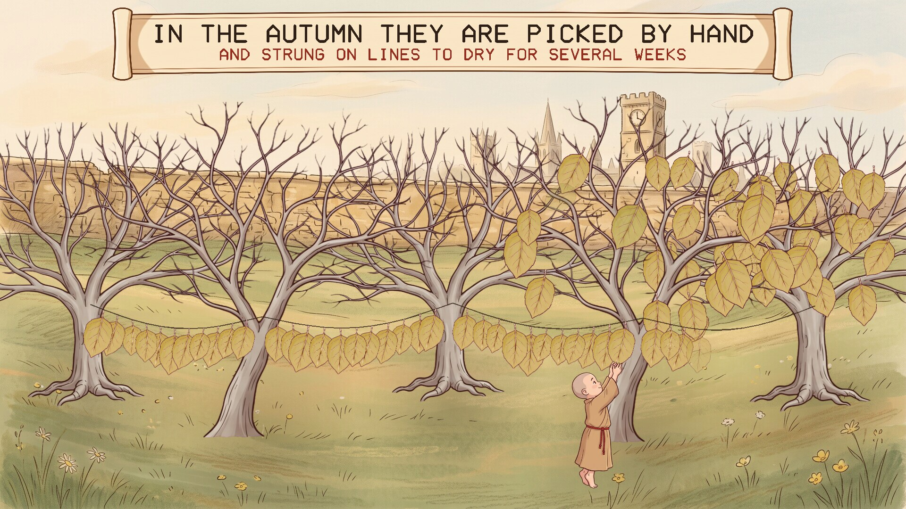
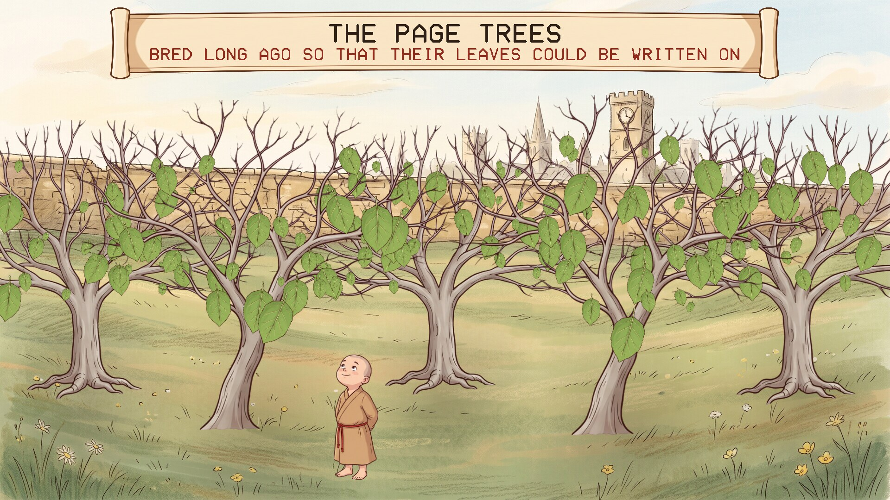
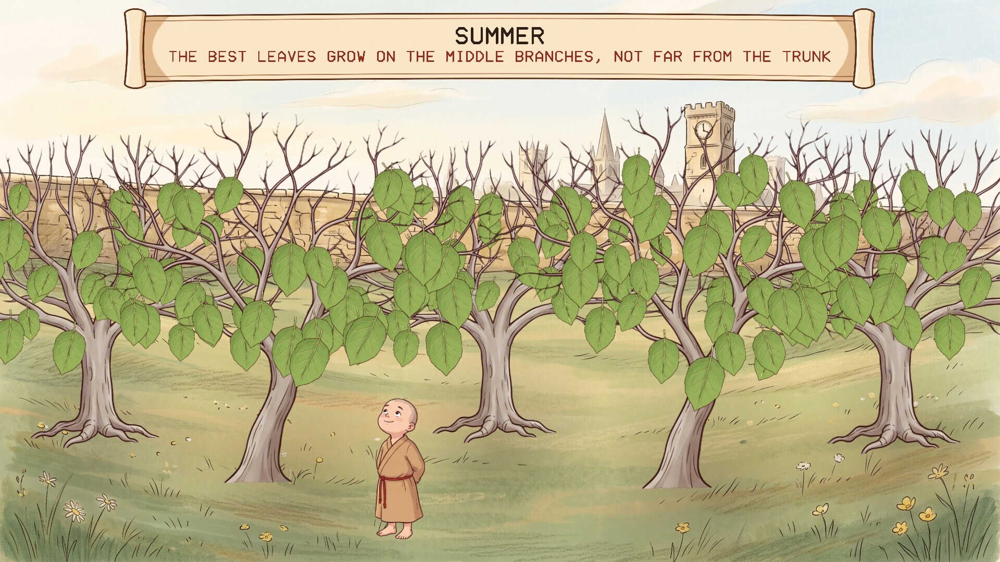
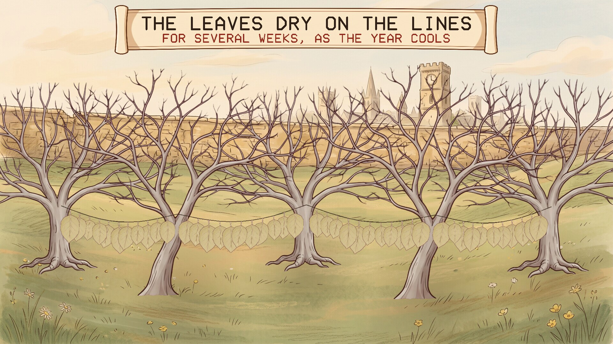
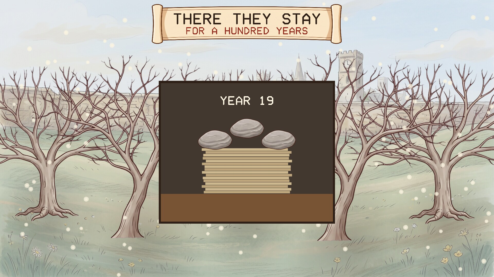

# The Page Trees

A quiet screensaver of the page trees, from Neal Stephenson's novel *Anathem*. Runs
on Linux, Windows and macOS. One of the
[Anathem screensavers](https://github.com/mottipython/anathem-screensavers).

## The trees

The avout write on leaves. Page trees were bred long ago so that their leaves could
be written on, and groves of them grow inside the concent. In the autumn the leaves
are picked by hand and strung on lines to dry for several weeks. Then they are
taken indoors, stacked, and pressed under stones, and left there for a hundred
years. After that they are cut into rectangles in cutting frames.

Only about one leaf in ten is good enough to make a page. Four in ten are too small
or too uneven to make a rectangle, more in a cold or dry year; others are spoiled by
insect holes or by thick veins. The best grow on the middle branches, not too far
from the trunk.

## What the screensaver shows

One grove, and a year going by in about three minutes. It begins at the season
it really is where you are (taking spring to start in March).

| | |
|---|---|
|  |  |
| Spring: the leaves unfurl | Summer |
|  |  |
| The leaves drying on the lines | Winter, and the stack under its stones |

In winter a window opens on indoors: the stack pressing flatter as the years count
to a hundred, then one leaf in the cutting frame, the square that is kept, and
writing appearing on it. Then it is spring again.

In the autumn the fraa goes from tree to tree with his basket: he reaches up, takes
hold of a leaf, brings it down and lays it in the basket at his feet, then carries
the basket on to the next tree.

Each leaf is the same leaf throughout: the golden and the dried ones are the green
one with its colour changed, so nothing changes shape as it turns.

### What is from the book and what is mine

From the book: everything under "The trees" above.

Mine: what the trees and the leaves look like, the lines being strung from tree to
tree, the snow, and squeezing a hundred years into half a minute.

## Install

Packages are on the [releases page](../../releases).

### Windows

Run `PageTrees-Setup-1.1.0.exe`. It asks for administrator rights, because Windows
only lists screensavers that are in its own system folder. After that "The Page Trees" is in Screen Saver Settings with the others, already selected. Uninstall from
Apps.

### macOS

There are two downloads on the releases page, for Apple Silicon and Intel, macOS 11
or later.

**The screen saver** is the file ending `-mac-screensaver.zip`. Unzip it and
double-click the `.saver` file; macOS offers to install it. Then choose it in System
Settings, Screen Saver (scroll to the end of the list, under Other).

**The app** is the file ending `-mac.zip`: the same thing as an ordinary program
that runs full screen until you press a key.

Neither is signed with an Apple developer certificate, so macOS will refuse them at
first. After the refusal, open System Settings, Privacy & Security, scroll down,
and click Open Anyway. If the screen saver still will not load, clear the
quarantine mark in Terminal:

    xattr -dr com.apple.quarantine ~/Library/"Screen Savers"

Both are built on a Mac build machine, where the screen saver is loaded and made to
draw as a test. They have not yet been tried by a person on a real Mac, and screen
savers on recent macOS are known to be temperamental; reports are welcome.

### Linux

**Fedora, Nobara** (built on Fedora 44):

    sudo dnf install ./page-trees-1.1.0-1.fc44.x86_64.rpm

**Debian, Ubuntu, Mint** (Ubuntu 24.04 / Debian 13 or later):

    sudo apt install ./page-trees_1.1.0_amd64.deb

From your next login it starts by itself after five minutes idle, and any key or
mouse movement ends it. To start the watcher without logging out, or to change the
delay:

    page-trees-screensaver enable 10    # after 10 minutes idle
    page-trees-screensaver disable
    page-trees-screensaver status
    page-trees-screensaver now          # run it right away

Wayland desktops have no screensaver service to plug into, so the package starts a
small idle watcher (`swayidle`) at login. It works on compositors that provide the
ext-idle-notify protocol: KDE Plasma, Sway, Hyprland, niri, COSMIC, labwc and
others. GNOME does not provide it, and on X11 you would add `page-trees` to
xscreensaver or your desktop's own idle settings. It does not lock the screen. If
one of the other *Anathem* screensavers
([Teglon](https://github.com/mottipython/teglon),
[the Lazy Peregrin](https://github.com/mottipython/lazy-peregrin),
[Cutting the Cake](https://github.com/mottipython/cutting-the-cake),
[the Clock of Saunt Edhar](https://github.com/mottipython/edhar-clock),
[the Weed War](https://github.com/mottipython/weed-war),
[the Daban Urnud](https://github.com/mottipython/daban-urnud),
[the Adrakhonic Theorem](https://github.com/mottipython/adrakhonic),
[the Analemma](https://github.com/mottipython/analemma),
[Bolt, Chord and Sphere](https://github.com/mottipython/bolt-chord-sphere),
[the Wick](https://github.com/mottipython/wick),
[A Fraa in Orbit](https://github.com/mottipython/fraa-in-orbit),
[Fly, Bat, Worm](https://github.com/mottipython/fly-bat-worm)) is already on screen it stays out of the way.

If [screensaver-service](https://github.com/mottipython/screensaver-service) is
installed, The Page Trees appears in its list of screen savers, and that service starts
it in place of the watcher described above.

## Running it yourself

    page-trees              full screen on every display; any key or mouse movement quits
    page-trees --window     in a window; Esc or Q quits
    page-trees --speed 2    faster
    page-trees --date 10-05 begin at this day of the year instead of today
    page-trees --snapshot out.bmp --time 60 --size 1920x1080

## Building

Needs a C compiler, make and SDL2 (2.0.18 or newer). Build from the top of the
source tree, because the pictures in `assets/art` are built into the program.

    make
    make check
    sudo make install

Packages are written to `dist/`. `tools/Containerfile` describes a container with
everything they need:

    podman build -t anathem-build -f tools/Containerfile tools
    podman run --rm --security-opt label=disable -v "$PWD":/src -w /src anathem-build make dist

## Credits and licence

MIT. *Anathem* and the page trees are Neal Stephenson's; this is an unofficial fan
project.

The pictures (the grove, the trees, the leaf, the stone, the frame, the fraa and the
scroll) were drawn with Google Gemini and prepared by `tools/make_sprites.py`.
Images are decoded with [stb_image](https://github.com/nothings/stb) (public
domain).
